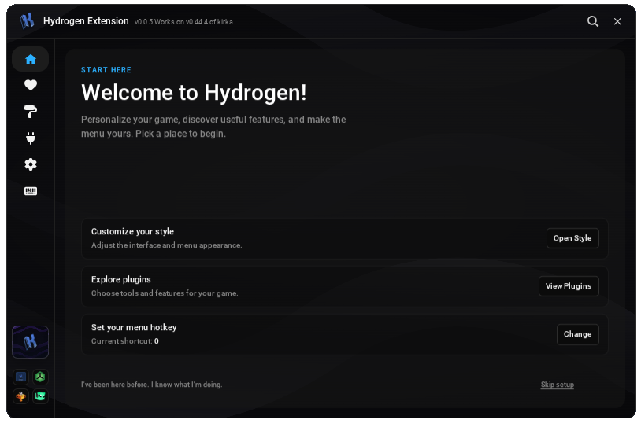

 

  

  <h1>Hydrogen Extension</h1>

    

  
   

  <h4>Links</h4>
  

    
    
  

For installation and usage instructions, see [Extension](https://chromewebstore.google.com/detail/hydrogen/mafpifbccegknkklokoajpaelpkhgndp)
